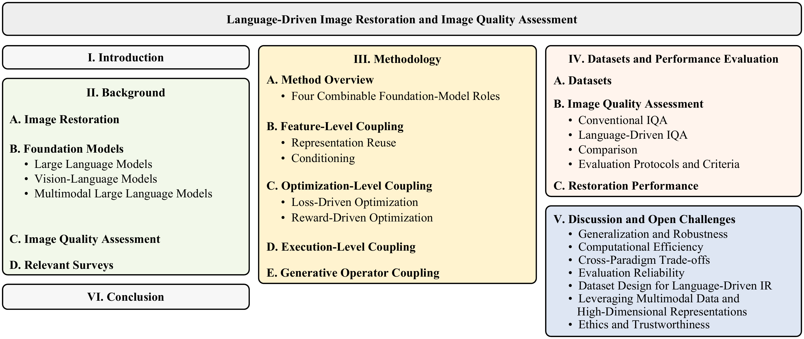
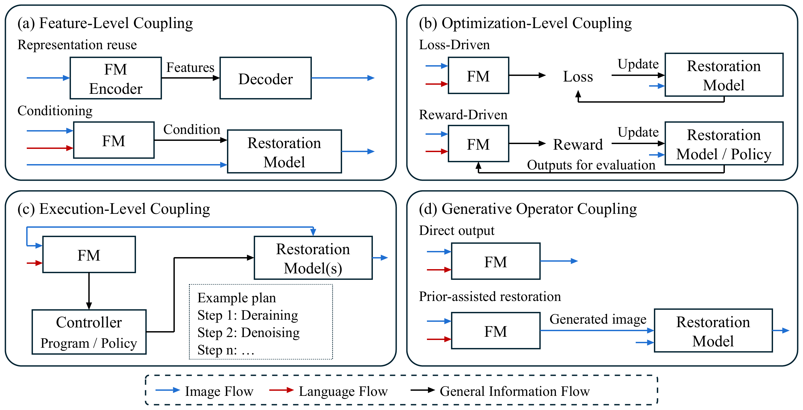
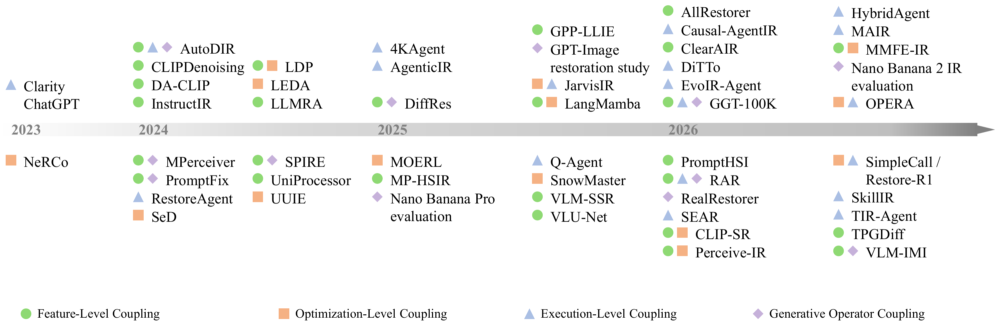

# Language-Driven Image Restoration and Semantic-Aware Quality Assessment: A Survey

<div align="center">
<a href="https://www.preprints.org/manuscript/202603.2366"></a>
<a href="https://github.com/MingyuLiu1/Language-Driven-IR-and-IQA/stargazers"></a>
<a href="https://github.com/MingyuLiu1/Language-Driven-IR-and-IQA/network/members"></a>
<a href="https://github.com/MingyuLiu1/Language-Driven-IR-and-IQA/issues"></a>
<a href="https://github.com/MingyuLiu1/Language-Driven-IR-and-IQA/blob/main/LICENSE"></a>
</div>

A structured repository for papers, taxonomy, benchmarks, and resources on language-driven image restoration (IR) and language-driven image quality assessment (IQA). This repository is maintained by [TUM-AIR](https://www.ce.cit.tum.de/air/home/) and will be continuously updated to track the latest work in the community.

## 📄 Abstract

Image restoration aims to recover a high-quality image from its degraded counterpart. Language-driven restoration integrates foundation models to extend this process through semantic reasoning and cross-modal knowledge. This survey organizes representative frameworks through an interaction-centric taxonomy encompassing feature-level, optimization-level, execution-level, and generative operator coupling, including methods with multiple roles. To examine how restoration quality is evaluated, language-driven image quality assessment is reviewed alongside conventional fidelity-based metrics, highlighting their complementary roles. Evaluation is further explored through commonly used datasets and cross-task performance comparisons. Finally, open challenges and future directions toward robust, efficient, and trustworthy restoration are discussed.

**Keywords: Image Restoration, Image Quality Assessment, Vision-Language Models, Multimodal Large Language Models**

<p align="center">

</p>

<details>
<summary><b>Restoration Prototypes</b></summary>

<p align="center">

</p>

The four panels show representation reuse and conditioning, loss- and reward-driven optimization, execution control, and direct or prior-assisted restoration. Prior-assisted restoration uses an additional restoration model.

</details>

<details>
<summary><b>Timeline</b></summary>

<p align="center">

</p>

The timeline covers 52 method families through 13 October 2026. Multiple symbols indicate multiple FM roles.

</details>

## :fire: Updates

- [November 20, 2026] Updated the taxonomy, paper lists, figures, IQA methods, and dataset resources.
- [April 08, 2026] Preprint released. [Read the preprint](https://www.preprints.org/manuscript/202603.2366).

## 🧭 Foundation-Model Roles

The interaction-centric taxonomy describes how foundation models (FMs) contribute to image restoration. The four roles are **non-exclusive**; a method can combine several roles across data construction, training, and inference.

| Label | Coupling Type | Role in Restoration |
|---|---|---|
| Rep | Feature-Level Coupling | FM-derived representations support feature reuse or conditioning in the restoration forward process. |
| Opt | Optimization-Level Coupling | FM outputs define losses, rewards, or supervision targets for training restoration models or control policies. |
| Exec | Execution-Level Coupling | FM outputs control the selection and execution of restoration modules, directly or through a program or learned policy. |
| Gen | Generative Operator Coupling | General-purpose image-generation or editing FMs generate restoration results, priors for another restoration model, or training references. |

A role does not imply that the FM is called during inference. In the method tables, † denotes FM-derived representations. AutoDIR has an Exec role in its multistep configuration; GGT-100K combines Rep, Gen, and Exec during offline training-data construction.

## 📚 Papers by Task

The following **52 method families** are organized by restoration task and cover work through **13 October 2026**. FM roles follow the interaction-centric taxonomy. Publication information follows the cited versions, and paper links may lead to their preprints. HSI denotes hyperspectral imaging.

Links to code, model weights, and project pages are provided where available. “—” indicates that no resource link is listed. Project pages are labeled separately.

<details>
<summary><b>Denoising</b></summary>

| Method / Paper | Venue | Task | Domain | FM Role(s) | Resources |
|---|---|---|---|---|---|
| **CLIPDenoising**<br>[Transfer CLIP for Generalizable Image Denoising](https://openaccess.thecvf.com/content/CVPR2024/papers/Cheng_Transfer_CLIP_for_Generalizable_Image_Denoising_CVPR_2024_paper.pdf) | CVPR 2024 | Denoising | Natural | Rep | [Code](https://github.com/alwaysuu/CLIPDenoising) · [Weights](https://drive.google.com/drive/folders/1F8md2zen0iPlhGnI5-VdjdBOLY8DBIiF?usp=drive_link) |
| **LEDA†**<br>[Low-Dose CT Denoising with Language-Engaged Dual-Space Alignment](https://arxiv.org/abs/2403.06128) | IEEE BIBM 2024 | CT denoising | Medical | Opt | [Code](https://github.com/hao1635/LEDA) · [Weights](https://drive.google.com/drive/folders/1hXlqCDpeJtk-JuYvndmU43Q77EaunlFd?usp=sharing) |
| **LangMamba†**<br>[LangMamba: A Language-Driven Mamba Framework for Low-Dose CT Denoising with Vision-Language Models](https://arxiv.org/abs/2507.06140) | IEEE TRPMS 2025 | CT denoising | Medical | Rep + Opt | [Code](https://github.com/hao1635/LangMamba) |

</details>

<details>
<summary><b>Desnowing</b></summary>

| Method / Paper | Venue | Task | Domain | FM Role(s) | Resources |
|---|---|---|---|---|---|
| **SnowMaster**<br>[SnowMaster: Comprehensive Real-world Image Desnowing via MLLM with Multi-Model Feedback Optimization](https://openaccess.thecvf.com/content/CVPR2025/papers/Lai_SnowMaster_Comprehensive_Real-world_Image_Desnowing_via_MLLM_with_Multi-Model_Feedback_CVPR_2025_paper.pdf) | CVPR 2025 | Desnowing | Natural | Opt | [Code](https://github.com/alexlai2860/SnowMaster) · [Weights](https://drive.google.com/drive/folders/1PYi1NGT2ASLRQ3vKyWdX0dUDGFNFIDk0?usp=sharing) |

</details>

<details>
<summary><b>Deblurring</b></summary>

| Method / Paper | Venue | Task | Domain | FM Role(s) | Resources |
|---|---|---|---|---|---|
| **LDP**<br>[LDP: Language-driven Dual-Pixel Image Defocus Deblurring Network](https://openaccess.thecvf.com/content/CVPR2024/papers/Yang_LDP_Language-driven_Dual-Pixel_Image_Defocus_Deblurring_Network_CVPR_2024_paper.pdf) | CVPR 2024 | Deblurring | Natural | Rep + Opt | [Code](https://github.com/noxsine/LDP) · [Weights](https://drive.google.com/drive/folders/1SrukcQo74xZDAoSqbs8avWnZcgox0m-h?usp=drive_link) |

</details>

<details>
<summary><b>Low-Light Image Enhancement</b></summary>

| Method / Paper | Venue | Task | Domain | FM Role(s) | Resources |
|---|---|---|---|---|---|
| **VLM-IMI**<br>[Adapting Large VLMs with Iterative and Manual Instructions for Generative Low-light Enhancement](https://doi.org/10.1109/CVPRF71909.2026.00465) | CVPR Findings 2026 | LLIE | Natural | Rep + Gen | [Code](https://github.com/sunxiaoran01/VLM-IMI) |
| **GPP-LLIE**<br>[Low-Light Image Enhancement via Generative Perceptual Priors](https://arxiv.org/pdf/2412.20916) | AAAI 2025 | LLIE | Natural | Rep | [Code](https://github.com/LowLevelAI/GPP-LLIE) · [Weights](https://mcmasteru365-my.sharepoint.com/:u:/g/personal/dongw22_mcmaster_ca/EWTcRm7rQc5Ao3qfLcc98wkBhBByYPnMN7csOPBJREV0TA) |
| **NeRCo**<br>[Implicit Neural Representation for Cooperative Low-light Image Enhancement](https://openaccess.thecvf.com/content/ICCV2023/papers/Yang_Implicit_Neural_Representation_for_Cooperative_Low-light_Image_Enhancement_ICCV_2023_paper.pdf) | ICCV 2023 | LLIE | Natural | Opt | [Code](https://github.com/Ysz2022/NeRCo) · [Weights](https://drive.google.com/file/d/1uL4u1iXN2xoVr4Owr5uZgYY3k03nvJZ3/view?usp=sharing) |

</details>

<details>
<summary><b>Super-Resolution</b></summary>

| Method / Paper | Venue | Task | Domain | FM Role(s) | Resources |
|---|---|---|---|---|---|
| **4KAgent**<br>[4KAgent: Agentic Any Image to 4K Super-Resolution](https://arxiv.org/pdf/2507.07105) | NeurIPS 2025 | SR | Natural / Medical / Remote sensing | Exec | [Code](https://github.com/taco-group/4KAgent) · [Tool weights](https://github.com/yuhaoliu7456/Diff-Plugin/tree/main/pre-trained/lowlight) · [Project page](https://4kagent.github.io) |
| **CLIP-SR**<br>[CLIP-SR: Collaborative Linguistic and Image Processing for Super-Resolution](https://arxiv.org/pdf/2412.11609) | IEEE TMM 2026 | SR | Natural | Rep + Opt | [Code](https://github.com/hengliusky/CLIP-SR) · [Weights](https://drive.google.com/file/d/14wHyiksnQVKeLegP6Gjv8UYWBP9-o1yd/view?usp=share_link) |
| **SeD**<br>[SeD: Semantic-Aware Discriminator for Image Super-Resolution](https://arxiv.org/pdf/2402.19387) | CVPR 2024 | SR | Natural | Opt | [Code](https://github.com/lbc12345/SeD) · [Weights](https://drive.google.com/drive/folders/18T9iUKgXh50z6dtCkpPnhIf51Ht0dtDZ?usp=drive_link) |
| **VLM-SSR**<br>[Advancing Real-World Stereoscopic Image Super-Resolution via Vision-Language Model](https://ieeexplore.ieee.org/document/10914541/) | IEEE TIP 2025 | SR | Natural | Rep | — |

</details>

<details>
<summary><b>Underwater Image Enhancement</b></summary>

| Method / Paper | Venue | Task | Domain | FM Role(s) | Resources |
|---|---|---|---|---|---|
| **UUIE**<br>[Unsupervised Underwater Image Enhancement Combining Imaging Restoration and Prompt Learning](https://link.springer.com/chapter/10.1007/978-981-97-8490-5_30) | PRCV 2024 | Underwater | Underwater | Opt | — |

</details>

<details>
<summary><b>All-in-One and Multi-Task Restoration</b></summary>

| Method / Paper | Venue | Task | Domain | FM Role(s) | Resources |
|---|---|---|---|---|---|
| **UniProcessor**<br>[UniProcessor: A Text-Induced Unified Low-Level Image Processor](https://arxiv.org/abs/2407.20928) | ECCV 2024 | All-in-One | Natural | Rep | [Code](https://github.com/IntMeGroup/UniProcessor) · [Weights](https://pan.sjtu.edu.cn/web/share/6bc57c1b6b3e43f0ea9d4f42c654417a) |
| **VLU-Net**<br>[Vision-Language Gradient Descent-Driven All-in-One Deep Unfolding Networks](https://openaccess.thecvf.com/content/CVPR2025/papers/Zeng_Vision-Language_Gradient_Descent-driven_All-in-One_Deep_Unfolding_Networks_CVPR_2025_paper.pdf) | CVPR 2025 | All-in-One | Natural | Rep | [Code](https://github.com/xianggkl/VLU-Net) · [Weights](https://drive.google.com/file/d/1214SfTO5LDMr3Ck_aVVUuZhuqhteMJ7P/view?usp=sharing) |
| **AllRestorer**<br>[All-in-One Transformer for Image Restoration under Adverse Weather Degradations](https://ieeexplore.ieee.org/stamp/stamp.jsp?tp=&arnumber=11367271) | IEEE TPAMI 2026 | All-in-One | Natural | Rep | — |
| **InstructIR**<br>[InstructIR: High-Quality Image Restoration Following Human Instructions](https://arxiv.org/pdf/2401.16468) | ECCV 2024 | All-in-One | Natural | Rep | [Code](https://github.com/mv-lab/InstructIR) · [Weights](https://huggingface.co/marcosv/InstructIR/tree/main) |
| **DiffRes**<br>[Adapting Text-to-Image Generation with Feature Difference Instruction for Generic Image Restoration](https://openaccess.thecvf.com/content/CVPR2025/papers/Wang_Adapting_Text-to-Image_Generation_with_Feature_Difference_Instruction_for_Generic_Image_CVPR_2025_paper.pdf) | CVPR 2025 | All-in-One | Natural | Rep + Gen | — |
| **MP-HSIR†**<br>[MP-HSIR: A Multi-Prompt Framework for Universal Hyperspectral Image Restoration](https://openaccess.thecvf.com/content/ICCV2025/papers/Wu_MP-HSIR_A_Multi-Prompt_Framework_for_Universal_Hyperspectral_Image_Restoration_ICCV_2025_paper.pdf) | ICCV 2025 | All-in-One | HSI | Rep | [Code](https://github.com/ZhehuiWu/MP-HSIR) · [Weights](https://drive.google.com/drive/folders/1J4OA_gUiZHGvYNvXDiaFwIvz8vC5D6xB?usp=drive_link) |
| **PromptHSI**<br>[PromptHSI: Universal Hyperspectral Image Restoration With Vision–Language Modulated Frequency Adaptation](https://doi.org/10.1109/TGRS.2026.3660506) | IEEE TGRS 2026 | All-in-One | HSI | Rep | [Code](https://github.com/chingheng0808/PromptHSI) · [Weights](https://drive.google.com/file/d/1H7NlKOLFKuN-wqGAizGKokydr4VuJ-Gg/view?usp=sharing) |
| **DA-CLIP**<br>[Controlling Vision-Language Models for Multi-Task Image Restoration](https://arxiv.org/pdf/2310.01018) | ICLR 2024 | All-in-One | Natural | Rep | [Code](https://github.com/Algolzw/daclip-uir) · [Weights](https://huggingface.co/weblzw/daclip-uir-ViT-B-32-irsde/tree/main) |
| **AutoDIR**<br>[AutoDIR: Automatic All-in-One Image Restoration with Latent Diffusion](https://arxiv.org/pdf/2310.10123) | ECCV 2024 | All-in-One | Natural | Rep + Gen + Exec (multistep Exec) | [Code](https://github.com/jiangyitong/AutoDIR) · [Weights](https://drive.google.com/drive/folders/1hVUyHY9FOUsEpFhPQPHmyd8diDNThqaU?usp=sharing) · [Project page](https://jiangyitong.github.io/AutoDIR_webpage/) |
| **SPIRE**<br>[SPIRE: Semantic Prompt-Driven Image Restoration](https://arxiv.org/abs/2312.11595) | ECCV 2024 | All-in-One | Natural | Rep + Gen | — |
| **MPerceiver**<br>[Multimodal Prompt Perceiver: Empower Adaptiveness, Generalizability and Fidelity for All-in-One Image Restoration](https://openaccess.thecvf.com/content/CVPR2024/papers/Ai_Multimodal_Prompt_Perceiver_Empower_Adaptiveness_Generalizability_and_Fidelity_for_All-in-One_CVPR_2024_paper.pdf) | CVPR 2024 | All-in-One | Natural | Rep + Gen | [Code](https://github.com/hhb072/MPerceiver-Code) |
| **TPGDiff†**<br>[TPGDiff: Hierarchical Triple-Prior Guided Diffusion for Image Restoration](https://arxiv.org/abs/2601.20306) | arXiv 2026 | All-in-One | Natural | Rep | [Code](https://github.com/LiHao-XUPT/TPGDiff) |
| **LLMRA**<br>[LLMRA: Multi-modal Large Language Model based Restoration Assistant](https://arxiv.org/pdf/2401.11401) | arXiv 2024 | All-in-One | Natural | Rep | — |
| **PromptFix**<br>[PromptFix: You Prompt and We Fix the Photo](https://arxiv.org/pdf/2405.16785) | NeurIPS 2024 | All-in-One | Natural | Rep + Gen | [Code](https://github.com/yeates/PromptFix) · [Weights](https://huggingface.co/yeates/PromptFix/resolve/main/promptfix.ckpt) · [Project page](https://www.yongshengyu.com/PromptFix-Page) |
| **ClearAIR**<br>[ClearAIR: A Human-Visual-Perception-Inspired All-in-One Image Restoration](https://arxiv.org/pdf/2601.02763) | AAAI 2026 | All-in-One | Natural | Rep | [Code](https://github.com/House-yuyu/ClearAIR) · [Weights](https://pan.baidu.com/s/1Mv5o0KPOjlMB-MhF4HcYtQ) |
| **Perceive-IR**<br>[Perceive-IR: Learning to Perceive Degradation Better for All-in-One Image Restoration](https://doi.org/10.1109/TIP.2025.3566300) | IEEE TIP 2026 | All-in-One | Natural | Rep + Opt | [Code](https://github.com/House-yuyu/Perceive-IR) · [Weights](https://pan.baidu.com/s/1r04w7uSwXZ6V8bE1X9BbMQ?pwd=k4uc) |
| **MOERL**<br>[MOERL: When Mixture-of-Experts Meet Reinforcement Learning for Adverse Weather Image Restoration](https://openaccess.thecvf.com/content/ICCV2025/html/Wang_MOERL_When_Mixture-of-Experts_Meet_Reinforcement_Learning_for_Adverse_Weather_Image_ICCV_2025_paper.html) | ICCV 2025 | All-in-One | Natural | Opt | — |
| **Restore-R1 (formerly SimpleCall)**<br>[Restore-R1: Efficient Image Restoration Agents via Reinforcement Learning with Multimodal LLM Perceptual Feedback](https://arxiv.org/pdf/2512.18599) | CVPR Findings 2026 | All-in-One | Natural | Opt + Exec | — |
| **RestoreAgent**<br>[RestoreAgent: Autonomous Image Restoration Agent via Multimodal Large Language Models](https://proceedings.neurips.cc/paper_files/paper/2024/file/c78f639424b8d89ceb4f2efbb4dfe4f4-Paper-Conference.pdf) | NeurIPS 2024 | All-in-One | Natural | Exec | — |
| **AgenticIR**<br>[An Intelligent Agentic System for Complex Image Restoration Problems](http://openreview.net/pdf?id=3RLxccFPHz) | ICLR 2025 | All-in-One | Natural | Exec | [Code](https://github.com/Kaiwen-Zhu/AgenticIR) · [Weights](https://drive.google.com/file/d/1o-PN1iXctWl62Tdb8fZs1eD1Ehv6HBMh/view?usp=drive_link) |
| **Q-Agent**<br>[Q-Agent: Quality-Driven Chain-of-Thought Image Restoration Agent through Robust Multimodal Large Language Model](https://arxiv.org/pdf/2504.07148) | arXiv 2025 | All-in-One | Natural | Exec | — |
| **MAIR**<br>[Multi-Agent Image Restoration](https://arxiv.org/pdf/2503.09403) | IJCV 2026 | All-in-One | Natural | Exec | — |
| **HybridAgent**<br>[Hybrid Agents for Image Restoration](https://arxiv.org/pdf/2503.10120) | CVPR 2026 | All-in-One | Natural | Exec | — |
| **Clarity ChatGPT**<br>[Clarity ChatGPT: An Interactive and Adaptive Processing System for Image Restoration and Enhancement](https://arxiv.org/pdf/2311.11695) | arXiv 2023 | All-in-One | Natural | Exec | — |
| **JarvisIR**<br>[JarvisIR: Elevating Autonomous Driving Perception with Intelligent Image Restoration](https://arxiv.org/pdf/2504.04158) | CVPR 2025 | All-in-One | Natural | Exec + Opt | [Code](https://github.com/LYL1015/JarvisIR) · [Weights](https://huggingface.co/LYL1015/JarvisIR/tree/main/pretrained/mrrhf) |
| **GPT-Image restoration study**<br>[A Preliminary Study on GPT-Image Generation Model for Image Restoration](https://arxiv.org/abs/2505.05621) | arXiv 2025 | Multiple tasks | Natural | Gen | — |
| **Nano Banana Pro evaluation**<br>[Is Nano Banana Pro a Low-Level Vision All-Rounder? A Comprehensive Evaluation on 14 Tasks and 40 Datasets](https://arxiv.org/abs/2512.15110) | arXiv 2025 | Multiple tasks | Multiple domains | Gen | [Code](https://github.com/Zplusdragon/LowLevelBanana) |
| **Nano Banana 2 IR evaluation**<br>[Can Nano Banana 2 Replace Traditional Image Restoration Models? An Evaluation of Its Performance on Image Restoration Tasks](https://arxiv.org/abs/2604.03061) | CVPR Workshops 2026 | Multiple tasks | Natural | Gen | — |
| **RealRestorer**<br>[RealRestorer: Towards Generalizable Real-World Image Restoration with Large-Scale Image Editing Models](https://arxiv.org/abs/2603.25502) | arXiv 2026 | Multiple tasks | Natural | Gen | [Code](https://github.com/yfyang007/RealRestorer) · [Weights](https://huggingface.co/RealRestorer/RealRestorer) |
| **GGT-100K**<br>[GGT-100K: Generative Ground Truth for Generalizable Real-World Image Restoration](https://arxiv.org/abs/2605.31039) | arXiv 2026 | Training-data construction | Natural | Rep + Gen + Exec (data construction) | [Code](https://github.com/PolyU-VCLab/GGT-100K) · [Weights](https://huggingface.co/datasets/VCLab-PolyU/GGT-100K/tree/main/pretrained-model) |
| **MMFE-IR**<br>[Leveraging Multimodal Large Language Models for All-in-One Image Restoration via a Mixture of Frequency Experts](https://arxiv.org/abs/2605.11444) | arXiv 2026 | All-in-One | Natural | Rep + Opt | — |
| **RAR**<br>[Restore, Assess, Repeat: A Unified Framework for Iterative Image Restoration](https://openaccess.thecvf.com/content/CVPR2026/papers/Chen_Restore_Assess_Repeat_A_Unified_Framework_for_Iterative_Image_Restoration_CVPR_2026_paper.pdf) | CVPR 2026 | All-in-One | Natural | Rep + Gen + Exec | [Code](https://github.com/saic-fi/RAR) · [Weights](https://huggingface.co/AaronCIH/RAR_modelzoo/tree/main/RAR/checkpoints) |
| **TIR-Agent**<br>[TIR-Agent: Training an Explorative and Efficient Agent for Image Restoration](https://arxiv.org/abs/2603.27742) | ECCV 2026 | All-in-One | Natural | Exec | — |
| **EvoIR-Agent**<br>[EvoIR-Agent: Self-Evolving Image Restoration Agentic System via Experience-Driven Learning](https://arxiv.org/abs/2605.22208) | arXiv 2026 | All-in-One | Natural | Exec | — |
| **OPERA**<br>[OPERA: An Agent for Image Restoration with End-to-End Joint Planning-Execution Optimization](https://arxiv.org/abs/2605.22104) | arXiv 2026 | All-in-One | Natural | Exec + Opt | [Code](https://github.com/xsyshuishui/Opera) |
| **DiTTo**<br>[DiTTo: Scalable Order-aware All-in-One Image Restoration Agent](https://arxiv.org/abs/2605.30915) | arXiv 2026 | All-in-One | Natural | Exec | — |
| **SEAR**<br>[Self-Evolving Agentic Image Restoration via Deliberate Planning and Intuitive Execution](https://link.springer.com/chapter/10.1007/978-3-032-37422-6_22) | ECCV 2026 | All-in-One | Natural | Exec | — |
| **Causal-AgentIR**<br>[Causal-AgentIR: Self-Evolving Causal Memory for Adaptive Image Restoration Agents](https://arxiv.org/abs/2607.21125) | arXiv 2026 | All-in-One | Natural | Exec | — |
| **SkillIR**<br>[SkillIR: Evolving Scene-Aware Skills for Agentic Image Restoration](https://arxiv.org/abs/2609.21468) | arXiv 2026 | All-in-One | Natural | Exec | — |

</details>

## ⚖️ Image Quality Assessment

Language-driven IQA complements conventional fidelity and perceptual measures. The tables distinguish IQA methods from benchmarks and from protocols used to evaluate their outputs. **Reference Images at Evaluation** indicates whether image references are needed at evaluation time, rather than whether training uses labels or clean images.

<details>
<summary><b>Conventional IQA Methods</b></summary>

| Method | Paper | Category | Sub-category | Reference Images at Evaluation |
|---|---|---|---|---|
| PSNR | N/A | Reference-Based | Non-Learning-Based | ✓ |
| SSIM | [Image quality assessment: from error visibility to structural similarity](https://ece.uwaterloo.ca/~z70wang/publications/ssim.pdf) | Reference-Based | Non-Learning-Based | ✓ |
| FSIM | [FSIM: A feature similarity index for image quality assessment](https://scholar.google.com/scholar?hl=zh-CN&as_sdt=0%2C5&q=FSIM%3A+A+feature+similarity+index+for+image+quality+assessment&btnG=) | Reference-Based | Non-Learning-Based | ✓ |
| MAE | N/A | Reference-Based | Non-Learning-Based | ✓ |
| MSE | N/A | Reference-Based | Non-Learning-Based | ✓ |
| RMSE | N/A | Reference-Based | Non-Learning-Based | ✓ |
| ERGAS | [On the performance evaluation of pan-sharpening techniques](https://www.researchgate.net/profile/Roger-King-4/publication/3449922_On_the_Performance_Evaluation_of_Pan-Sharpening_Techniques/links/0fcfd509845bd01bc9000000/On-the-Performance-Evaluation-of-Pan-Sharpening-Techniques.pdf) | Reference-Based | Non-Learning-Based | ✓ |
| LOE | [Naturalness preserved enhancement algorithm for non-uniform illumination images](https://ieeexplore.ieee.org/document/6512558) | Reference-Based | Non-Learning-Based | ✓ |
| LPIPS | [The unreasonable effectiveness of deep features as a perceptual metric](https://arxiv.org/abs/1801.03924) | Reference-Based | Learning-Based | ✓ |
| DISTS | [Image quality assessment: Unifying structure and texture similarity](https://arxiv.org/abs/2004.07728) | Reference-Based | Learning-Based | ✓ |
| CKDN | [Learning conditional knowledge distillation for degraded-reference image quality assessment](https://arxiv.org/abs/2108.07948) | Reference-Based | Learning-Based | ✓ |
| AHIQ | [Attentions help cnns see better: Attention-based hybrid image quality assessment network](https://openaccess.thecvf.com/content/CVPR2022W/NTIRE/html/Lao_Attentions_Help_CNNs_See_Better_Attention-Based_Hybrid_Image_Quality_Assessment_CVPRW_2022_paper.html) | Reference-Based | Learning-Based | ✓ |
| TOPIQ-FR | [Topiq: A top-down approach from semantics to distortions for image quality assessment](https://arxiv.org/abs/2308.03060) | Reference-Based | Learning-Based | ✓ |
| FID | [Gans trained by a two time-scale update rule converge to a local nash equilibrium](https://arxiv.org/abs/1706.08500) | Reference-Based | Distribution-Based | ✓ |
| BRISQUE | [No-reference image quality assessment in the spatial domain](https://www.live.ece.utexas.edu/publications/2012/TIP%20BRISQUE.pdf) | No-Reference | Hand-Crafted | × |
| NIQE | [Making a “completely blind” image quality analyzer](https://www.live.ece.utexas.edu/publications/2013/mittal2013.pdf) | No-Reference | Hand-Crafted | × |
| PIQE | [Blind image quality evaluation using perception based features](https://ieeexplore.ieee.org/document/7084843) | No-Reference | Hand-Crafted | × |
| PI | [The 2018 PIRM challenge on perceptual image super-resolution](https://arxiv.org/pdf/1809.07517) | No-Reference | Hand-Crafted | × |
| MUSIQ | [Musiq: Multi-scale image quality transformer](https://arxiv.org/abs/2108.05997) | No-Reference | Learning-Based | × |
| MANIQA | [Maniqa: Multi-dimension attention network for no-reference image quality assessment](https://arxiv.org/abs/2204.08958) | No-Reference | Learning-Based | × |
| NIMA | [NIMA: Neural image assessment](https://ieeexplore.ieee.org/stamp/stamp.jsp?arnumber=8352823) | No-Reference | Learning-Based | × |
| HyperIQA | [Blindly assess image quality in the wild guided by a self-adaptive hyper network](https://openaccess.thecvf.com/content_CVPR_2020/html/Su_Blindly_Assess_Image_Quality_in_the_Wild_Guided_by_a_CVPR_2020_paper.html) | No-Reference | Learning-Based | × |
| PAQ2-PIQ | [From patches to pictures (PaQ-2-PiQ): Mapping the perceptual space of picture quality](https://openaccess.thecvf.com/content_CVPR_2020/html/Ying_From_Patches_to_Pictures_PaQ-2-PiQ_Mapping_the_Perceptual_Space_of_CVPR_2020_paper.html) | No-Reference | Learning-Based | × |
| DBCNN | [Blind image quality assessment using a deep bilinear convolutional neural network](https://arxiv.org/pdf/1907.02665) | No-Reference | Learning-Based | × |
| TOPIQ-NR | [Topiq: A top-down approach from semantics to distortions for image quality assessment](https://arxiv.org/abs/2308.03060) | No-Reference | Learning-Based | × |
| CNNIQA | [Convolutional neural networks for no-reference image quality assessment](https://www.cv-foundation.org/openaccess/content_cvpr_2014/html/Kang_Convolutional_Neural_Networks_2014_CVPR_paper.html) | No-Reference | Learning-Based | × |
| UNIQUE | [Uncertainty-Aware Blind Image Quality Assessment in the Laboratory and Wild](https://arxiv.org/abs/2005.13983) | No-Reference | Learning-Based | × |
| LwF-KG | [Continual Learning for Blind Image Quality Assessment](https://doi.org/10.1109/TPAMI.2022.3178874) | No-Reference | Learning-Based | × |
| TSN-IQA | [Task-Specific Normalization for Continual Learning of Blind Image Quality Models](https://arxiv.org/abs/2107.13429) | No-Reference | Learning-Based | × |
| PromptIQA | [Promptiqa: Boosting the performance and generalization for no-reference image quality assessment via prompts](https://arxiv.org/abs/2403.04993) | No-Reference | Learning-Based | × |

LOE compares the enhanced image with its input image. CKDN uses a degraded image as its evaluation reference, with clean images used only during training. FID compares image-set distributions and does not require paired clean targets. PromptIQA uses image-score pairs as prompts and belongs to conventional learning-based NR-IQA.

</details>

<details>
<summary><b>Language-Driven IQA Methods</b></summary>

Alignment-based methods use language-informed representations; reasoning-based methods produce quality explanations or judgments; scoring-based methods predict or calibrate numerical quality scores.

| Method | Paper | Sub-category | Reference Images at Evaluation |
|---|---|---|---|
| CLIP-IQA | [Exploring clip for assessing the look and feel of images](https://arxiv.org/abs/2207.12396) | Alignment-Based | × |
| QualiCLIP | [Quality-aware image-text alignment for opinion-unaware image quality assessment](https://arxiv.org/abs/2403.11176) | Alignment-Based | × |
| LIQE | [Blind image quality assessment via vision-language correspondence: A multitask learning perspective](https://arxiv.org/abs/2303.14968) | Alignment-Based | × |
| SCUIA | [Semantic Contrast for Domain-Robust Underwater Image Quality Assessment](https://ieeexplore.ieee.org/abstract/document/11353920) | Alignment-Based | × |
| GRMP-IQA | [Few-Shot Image Quality Assessment via Adaptation of Vision-Language Models](https://arxiv.org/abs/2409.05381) | Alignment-Based | × |
| ATTIQA | [ATTIQA: Generalizable image quality feature extractor using attribute-aware pretraining](https://arxiv.org/abs/2406.01020) | Alignment-Based | × |
| CAP-IQA | [CAP-IQA: Context-Aware Prompt-Guided CT Image Quality Assessment](https://arxiv.org/abs/2601.01613) | Alignment-Based | × |
| SFD-IQA | [Exploring semantic feature discrimination for perceptual image super-resolution and opinion-unaware no-reference image quality assessment](https://openaccess.thecvf.com/content/CVPR2025/html/Dong_Exploring_Semantic_Feature_Discrimination_for_Perceptual_Image_Super-Resolution_and_Opinion-Unaware_CVPR_2025_paper.html) | Alignment-Based | × |
| UniQA | [UniQA: Unified vision-language pre-training for image quality and aesthetic assessment](https://arxiv.org/abs/2406.01069) | Alignment-Based | × |
| RALI | [Reasoning as Representation: Rethinking Visual Reinforcement Learning in Image Quality Assessment](https://arxiv.org/abs/2510.11369) | Alignment-Based | × |
| DepictQA | [Depicting beyond scores: Advancing image quality assessment through multi-modal language models](https://arxiv.org/abs/2312.08962) | Reasoning-Based | × |
| DepictQA-Wild | [Descriptive image quality assessment in the wild](https://arxiv.org/abs/2405.18842) | Reasoning-Based | × |
| IQAGPT | [IQAGPT: computed tomography image quality assessment with vision-language and ChatGPT models](https://vciba.springeropen.com/articles/10.1186/s42492-024-00171-w) | Reasoning-Based | × |
| Co-Instruct | [Towards open-ended visual quality comparison](https://arxiv.org/abs/2402.16641) | Reasoning-Based | × |
| Q-Ground | [Q-Ground: Image quality grounding with large multi-modality models](https://arxiv.org/abs/2407.17035) | Reasoning-Based | × |
| SEAGULL | [Seagull: No-reference image quality assessment for regions of interest via vision-language instruction tuning](https://arxiv.org/abs/2411.10161) | Reasoning-Based | × |
| AgenticIQA | [Agenticiqa: An agentic framework for adaptive and interpretable image quality assessment](https://arxiv.org/abs/2509.26006) | Reasoning-Based | × |
| Q-Align | [Q-align: Teaching lmms for visual scoring via discrete text-defined levels](https://arxiv.org/abs/2312.17090) | Scoring-Based | × |
| DeQA-Score | [Teaching large language models to regress accurate image quality scores using score distribution](https://arxiv.org/abs/2501.11561) | Scoring-Based | × |
| Dog-IQA | [Dog-IQA: Standard-guided Zero-shot MLLM for Mix-grained Image Quality Assessment](https://arxiv.org/abs/2410.02505) | Scoring-Based | × |
| Q-Scorer | [Revisiting MLLM Based Image Quality Assessment: Errors and Remedy](https://arxiv.org/abs/2511.07812) | Scoring-Based | × |
| Compare2Score | [Adaptive image quality assessment via teaching large multimodal model to compare](https://arxiv.org/abs/2405.19298) | Scoring-Based | × |
| Q-Insight | [Q-insight: Understanding image quality via visual reinforcement learning](https://arxiv.org/abs/2503.22679) | Scoring-Based | × |
| Q-Ponder | [Q-ponder: A unified training pipeline for reasoning-based visual quality assessment](https://arxiv.org/abs/2506.05384) | Scoring-Based | × |
| Q-Hawkeye | [Q-Hawkeye: Reliable Visual Policy Optimization for Image Quality Assessment](https://arxiv.org/abs/2601.22920) | Scoring-Based | × |
| LEAF | [Decoupling Perception and Calibration: Label-Efficient Image Quality Assessment Framework](https://arxiv.org/abs/2601.20689) | Scoring-Based | × |

</details>

<details>
<summary><b>IQA Resources and Benchmarks</b></summary>

| Resource | Paper | Purpose |
|---|---|---|
| Q-Bench | [Q-bench: A benchmark for general-purpose foundation models on low-level vision](https://arxiv.org/abs/2309.14181) | Benchmark for low-level visual understanding and quality assessment |
| Q-Bench+ | [Q-Bench + : A Benchmark for Multi-Modal Foundation Models on Low-Level Vision From Single Images to Pairs](https://arxiv.org/pdf/2402.07116) | Benchmark extending low-level visual assessment from single images to pairs |
| Q-Instruct | [Q-instruct: Improving low-level visual abilities for multi-modality foundation models](https://arxiv.org/abs/2311.06783) | Instruction data for low-level visual understanding |

</details>

<details>
<summary><b>Evaluation Protocols</b></summary>

PLCC, SRCC, and KRCC measure agreement with human ratings rather than image quality directly. Human-aligned protocols do not require clean reference images, but they do require subjective ratings or judgments. Task-oriented and text-based protocols use the corresponding annotations or reference texts.

| Protocol | Paper | Sub-category | Evaluation Reference |
|---|---|---|---|
| PLCC | N/A | Human-Aligned | Human ratings or judgments |
| SRCC | N/A | Human-Aligned | Human ratings or judgments |
| KRCC | A new measure of rank correlation | Human-Aligned | Human ratings or judgments |
| Weighted Kappa | Interrater reliability and agreement of subjective judgments | Human-Aligned | Human ratings or judgments |
| Percent Agreement | N/A | Human-Aligned | Human ratings or judgments |
| Precision | N/A | Task-Oriented | Task labels / annotations |
| Recall | N/A | Task-Oriented | Task labels / annotations |
| F1 | N/A | Task-Oriented | Task labels / annotations |
| mIoU | N/A | Task-Oriented | Task labels / annotations |
| Accuracy | [Depicting beyond scores: Advancing image quality assessment through multi-modal language models](https://arxiv.org/abs/2312.08962) | Task-Oriented | Task labels / annotations |
| BLEU-N | [Bleu: a method for automatic evaluation of machine translation](https://research.ibm.com/publications/bleu-a-method-for-automatic-evaluation-of-machine-translation) | Text-Based | Reference texts |
| ROUGE-L | [Rouge: A package for automatic evaluation of summaries](https://www.microsoft.com/en-us/research/publication/rouge-a-package-for-automatic-evaluation-of-summaries/) | Text-Based | Reference texts |
| METEOR | [METEOR: An automatic metric for MT evaluation with improved correlation with human judgments](https://aclanthology.org/W05-0909.pdf) | Text-Based | Reference texts |
| CIDEr | [Cider: Consensus-based image description evaluation](https://arxiv.org/abs/1411.5726) | Text-Based | Reference texts |

</details>

## 📊 Datasets

**Reference** identifies the linked publication or resource, whose publication year may differ from the dataset year. HSI denotes hyperspectral imaging.

<details>
<summary><b>Denoising</b></summary>

| Dataset | Dataset Year | Reference | Task | Domain |
|---|---|---|---|---|
| [Kodak24](https://doi.org/10.6084/m9.figshare.26827765) | 1999 | 1999 | Denoising | Natural |
| [McMaster](https://doi.org/10.1117/1.3600632/) | 2011 | SPIE 2011 | Denoising | Natural |
| [CBSD68](https://doi.org/10.1109/ICCV.2001.937655) | 2001 | ICCV 2001 | Denoising | Natural |
| [Urban100](https://www.cv-foundation.org/openaccess/content_cvpr_2015/papers/Huang_Single_Image_Super-Resolution_2015_CVPR_paper.pdf) | 2015 | CVPR 2015 | Denoising | Natural |
| [DIV2K](https://openaccess.thecvf.com/content_cvpr_2017_workshops/w12/papers/Agustsson_NTIRE_2017_Challenge_CVPR_2017_paper.pdf) | 2017 | CVPR 2017 | Denoising | Natural |
| [SIDD](https://openaccess.thecvf.com/content_cvpr_2018/papers/Abdelhamed_A_High-Quality_Denoising_CVPR_2018_paper.pdf) | 2018 | CVPR 2018 | Denoising | Natural |
| [PolyU](https://doi.org/10.48550/arXiv.1804.02603) | 2018 | arXiv 2018 | Denoising | Natural |
| [WED](https://doi.org/10.1109/TIP.2016.2631888) | 2016 | IEEE TIP 2016 | Denoising | Natural |
| [BSD400](https://doi.org/10.1109/TPAMI.2010.161) | 2010 | IEEE TPAMI 2010 | Denoising | Natural |
| [Mayo-2016](https://doi.org/10.1002/mp.12345) | 2016 | MP 2017 | Denoising | Medical |

</details>

<details>
<summary><b>Deraining</b></summary>

| Dataset | Dataset Year | Reference | Task | Domain |
|---|---|---|---|---|
| [Rain100L](https://openaccess.thecvf.com/content_cvpr_2017/papers/Yang_Deep_Joint_Rain_CVPR_2017_paper.pdf) | 2017 | CVPR 2017 | Deraining | Natural |
| [Rain100H](https://openaccess.thecvf.com/content_cvpr_2017/papers/Yang_Deep_Joint_Rain_CVPR_2017_paper.pdf) | 2017 | CVPR 2017 | Deraining | Natural |
| [Rain800](https://doi.org/10.1109/TCSVT.2019.2920407) | 2019 | IEEE TCSVT 2019 | Deraining | Natural |
| [Rain1400](https://openaccess.thecvf.com/content_cvpr_2017/papers/Fu_Removing_Rain_From_CVPR_2017_paper.pdf) | 2017 | CVPR 2017 | Deraining | Natural |
| [Raindrop](https://openaccess.thecvf.com/content_cvpr_2018/papers/Qian_Attentive_Generative_Adversarial_CVPR_2018_paper.pdf) | 2018 | CVPR 2018 | Deraining | Natural |
| [Outdoor-Rain](https://openaccess.thecvf.com/content_CVPR_2019/papers/Li_Heavy_Rain_Image_Restoration_Integrating_Physics_Model_and_Conditional_Adversarial_CVPR_2019_paper.pdf) | 2019 | CVPR 2019 | Deraining | Natural |
| [RainDS](https://openaccess.thecvf.com/content/CVPR2021/papers/Quan_Removing_Raindrops_and_Rain_Streaks_in_One_Go_CVPR_2021_paper.pdf) | 2021 | CVPR 2021 | Deraining | Natural |
| [SSID](https://doi.org/10.1109/TPAMI.2022.3180560) | 2022 | IEEE TPAMI 2022 | Deraining | Natural |
| [LHP](https://openaccess.thecvf.com/content/ICCV2023/papers/Guo_From_Sky_to_the_Ground_A_Large-scale_Benchmark_and_Simple_ICCV_2023_paper.pdf) | 2023 | ICCV 2023 | Deraining | Natural |

</details>

<details>
<summary><b>Dehazing</b></summary>

| Dataset | Dataset Year | Reference | Task | Domain |
|---|---|---|---|---|
| [FoggyCityscapes](https://doi.org/10.1007/s11263-018-1072-8) | 2018 | IJCV 2018 | Dehazing | Natural |
| [ACDC](https://doi.org/10.1109/ICCV48922.2021.01059) | 2021 | ICCV 2021 | Dehazing | Natural |
| [RESIDE](https://doi.org/10.1109/TIP.2018.2867951) | 2018 | IEEE TIP 2018 | Dehazing | Natural |
| [NH-HAZE](https://openaccess.thecvf.com/content_CVPRW_2020/papers/w31/Ancuti_NH-HAZE_An_Image_Dehazing_Benchmark_With_Non-Homogeneous_Hazy_and_Haze-Free_CVPRW_2020_paper.pdf) | 2020 | CVPR Workshops 2020 | Dehazing | Natural |
| [Dense-Haze](https://doi.org/10.1109/ICIP.2019.8803046) | 2019 | ICIP 2019 | Dehazing | Natural |

</details>

<details>
<summary><b>Desnowing</b></summary>

| Dataset | Dataset Year | Reference | Task | Domain |
|---|---|---|---|---|
| [RealSnow10K](https://openaccess.thecvf.com/content/CVPR2025/papers/Lai_SnowMaster_Comprehensive_Real-world_Image_Desnowing_via_MLLM_with_Multi-Model_Feedback_CVPR_2025_paper.pdf) | 2025 | CVPR 2025 | Desnowing | Natural |
| [Snow100K-L](https://doi.org/10.1109/TIP.2018.2806202) | 2018 | IEEE TIP 2018 | Desnowing | Natural |

</details>

<details>
<summary><b>Deblurring</b></summary>

| Dataset | Dataset Year | Reference | Task | Domain |
|---|---|---|---|---|
| [DPD-blur](https://doi.org/10.1007/978-3-030-58607-2_7) | 2020 | ECCV 2020 | Deblurring | Natural |
| [DPD-disp](https://doi.org/10.1109/ICCP48838.2020.9105278) | 2020 | ICCP 2020 | Deblurring | Natural |
| [DDD-syn](https://openaccess.thecvf.com/content/CVPR2021/papers/Pan_Dual_Pixel_Exploration_Simultaneous_Depth_Estimation_and_Image_Restoration_CVPR_2021_paper.pdf) | 2021 | CVPR 2021 | Deblurring | Natural |
| [RDPD](https://openaccess.thecvf.com/content/ICCV2021/papers/Abuolaim_Learning_To_Reduce_Defocus_Blur_by_Realistically_Modeling_Dual-Pixel_Data_ICCV_2021_paper.pdf) | 2021 | ICCV 2021 | Deblurring | Natural |
| [GoPro](https://openaccess.thecvf.com/content_cvpr_2017/papers/Nah_Deep_Multi-Scale_Convolutional_CVPR_2017_paper.pdf) | 2017 | CVPR 2017 | Deblurring | Natural |

</details>

<details>
<summary><b>Low-Light Image Enhancement</b></summary>

| Dataset | Dataset Year | Reference | Task | Domain |
|---|---|---|---|---|
| [LOL-v1](https://doi.org/10.48550/arXiv.1808.04560) | 2018 | arXiv 2018 | LLIE | Natural |
| [LSRW](https://doi.org/10.1016/j.jvcir.2022.103712) | 2023 | JVCIR 2023 | LLIE | Natural |
| [DICM](https://doi.org/10.1109/TIP.2013.2284059) | 2013 | IEEE TIP 2013 | LLIE | Natural |
| [NPE](https://doi.org/10.1109/TIP.2013.2261309) | 2013 | IEEE TIP 2013 | LLIE | Natural |
| [VV](https://doi.org/10.1007/s11042-017-4783-x) | 2018 | MTA 2018 | LLIE | Natural |
| [LOL-v2-real](https://doi.org/10.1109/TIP.2021.3050850) | 2021 | IEEE TIP 2021 | LLIE | Natural |
| [LOL-v2-syn](https://doi.org/10.1109/TIP.2021.3050850) | 2021 | IEEE TIP 2021 | LLIE | Natural |
| [MEF](https://doi.org/10.1109/TIP.2015.2442920) | 2015 | IEEE TIP 2015 | LLIE | Natural |
| [SICE](https://doi.org/10.1109/TIP.2018.2794218) | 2018 | IEEE TIP 2018 | LLIE | Natural |
| [LIME](https://doi.org/10.1109/TIP.2016.2639450) | 2016 | IEEE TIP 2016 | LLIE | Natural |

</details>

<details>
<summary><b>Super-Resolution</b></summary>

| Dataset | Dataset Year | Reference | Task | Domain |
|---|---|---|---|---|
| [Set5](http://dx.doi.org/10.5244/C.26.135) | 2012 | BMVC 2012 | SR | Natural |
| [Set14](https://doi.org/10.1007/978-3-642-27413-8_47) | 2010 | ICCS 2010 | SR | Natural |
| [Manga109](https://doi.org/10.1007/s11042-016-4020-z) | 2017 | MTA 2017 | SR | Natural |
| [CelebA](https://mmlab.ie.cuhk.edu.hk/projects/CelebA.html) | 2015 | ICCV 2015 | SR | Natural |
| [RealSR](https://openaccess.thecvf.com/content_ICCV_2019/papers/Cai_Toward_Real-World_Single_Image_Super-Resolution_A_New_Benchmark_and_a_ICCV_2019_paper.pdf) | 2019 | ICCV 2019 | SR | Natural |
| [DrealSR](https://doi.org/10.1007/978-3-030-58598-3_7) | 2020 | ECCV 2020 | SR | Natural |
| [DIV2K-Val](https://openaccess.thecvf.com/content/CVPR2024/papers/Wu_SeeSR_Towards_Semantics-Aware_Real-World_Image_Super-Resolution_CVPR_2024_paper.pdf) | 2024 | CVPR 2024 | SR | Natural |
| [RealSRSet](https://openaccess.thecvf.com/content/ICCV2021/papers/Zhang_Designing_a_Practical_Degradation_Model_for_Deep_Blind_Image_Super-Resolution_ICCV_2021_paper.pdf) | 2021 | ICCV 2021 | SR | Natural |
| [DIV4K-50](https://doi.org/10.48550/arXiv.2507.07105) | 2025 | arXiv 2025 | SR | Natural |
| [DiffusionDB](https://doi.org/10.18653/v1/2023.acl-long.51) | 2023 | ACL 2023 | SR | Natural |
| [AID](https://doi.org/10.1109/TGRS.2017.2685945) | 2017 | TGRS 2017 | SR | Natural |
| [DIOR](https://doi.org/10.1016/j.isprsjprs.2019.11.023) | 2019 | ISPRS 2020 | SR | Natural |
| [DOTA](https://openaccess.thecvf.com/content_cvpr_2018/papers/Xia_DOTA_A_Large-Scale_CVPR_2018_paper.pdf) | 2018 | CVPR 2018 | SR | Natural |
| [bcSR](https://doi.org/10.7717/peerj-cs.1196) | 2023 | PeerJ 2023 | SR | Medical |
| [US-Case](https://www.ultrasoundcases.info/) | 2025 | 2025 | SR | Medical |

</details>

<details>
<summary><b>Underwater Image Enhancement</b></summary>

| Dataset | Dataset Year | Reference | Task | Domain |
|---|---|---|---|---|
| [EUVP](https://doi.org/10.1109/LRA.2020.2974710) | 2019 | LRA 2020 | Underwater | Underwater |
| [UIEB](https://doi.org/10.1109/TIP.2019.2955241) | 2019 | IEEE TIP 2019 | Underwater | Underwater |
| [RUIE](https://doi.org/10.1109/TCSVT.2019.2963772) | 2020 | IEEE TCSVT 2020 | Underwater | Underwater |

</details>

<details>
<summary><b>Composite</b></summary>

| Dataset | Dataset Year | Reference | Task | Domain |
|---|---|---|---|---|
| [PromptFix](https://doi.org/10.48550/arXiv.2405.16785) | 2024 | NeurIPS 2024 | Composite | Natural |
| [MiO100](https://doi.org/10.48550/arXiv.2401.03379) | 2024 | arXiv 2024 | Composite | Natural |
| [AgenticIR](https://doi.org/10.48550/arXiv.2410.17809) | 2025 | ICLR 2025 | Composite | Natural |
| [CleanBench](https://openaccess.thecvf.com/content/CVPR2025/papers/Lin_JarvisIR_Elevating_Autonomous_Driving_Perception_with_Intelligent_Image_Restoration_CVPR_2025_paper.pdf) | 2025 | CVPR 2025 | Composite | Natural |
| [CleanBench-Real](https://openaccess.thecvf.com/content/CVPR2025/papers/Lin_JarvisIR_Elevating_Autonomous_Driving_Perception_with_Intelligent_Image_Restoration_CVPR_2025_paper.pdf) | 2025 | CVPR 2025 | Composite | Natural |
| [MSRS](https://doi.org/10.1016/j.inffus.2022.03.007) | 2022 | IF 2022 | Composite | Natural |
| [FMB](https://openaccess.thecvf.com/content/ICCV2023/papers/Liu_Multi-interactive_Feature_Learning_and_a_Full-time_Multi-modality_Benchmark_for_Image_ICCV_2023_paper.pdf) | 2023 | ICCV 2023 | Composite | Natural |
| [CDD-11](https://doi.org/10.1007/978-3-031-72655-2_15) | 2024 | ECCV 2024 | Composite | Natural |
| [TOLED](https://openaccess.thecvf.com/content/CVPR2021/papers/Zhou_Image_Restoration_for_Under-Display_Camera_CVPR_2021_paper.pdf) | 2021 | CVPR 2021 | Composite | Natural |
| [AVIRIS](https://doi.org/10.1109/TGRS.2024.3378849) | 2024 | TGRS 2024 | Composite | HSI |
| [ARAD](https://openaccess.thecvf.com/content/CVPR2022W/NTIRE/papers/Arad_NTIRE_2022_Spectral_Recovery_Challenge_and_Data_Set_CVPRW_2022_paper.pdf) | 2022 | CVPR Workshops 2022 | Composite | HSI |

CleanBench contains 150K instruction-response pairs. CleanBench-Real contains 80K real images, including a 2K-image evaluation subset. These quantities describe different units and should not be treated as a training/testing image split.

</details>

[GGT-100K](https://arxiv.org/abs/2605.31039) pairs real degraded images with generated references selected through quality assessment. These generated references are supervision candidates rather than observed clean ground truth. [Dataset and project resources](https://github.com/PolyU-VCLab/GGT-100K).

## 🤝 &nbsp; Citation

Please visit [Language-Driven Image Restoration and Semantic-Aware Quality Assessment: A Survey](https://www.preprints.org/manuscript/202603.2366) for more details and comprehensive information. If you find our paper and repo helpful, please consider citing it as follows:

```BibTex
@article{liu2026language,
  title={Language-Driven Image Restoration and Semantic-Aware Quality Assessment: A Survey},
  author={Liu, Mingyu and Shu, Haozhan and Cui, Yuning and Zhou, Xingcheng and Cao, Hu and Ren, Wenqi and Shi, Boxin and Knoll, Alois C},
  year={2026},
  publisher={Preprints}
}
```


## 🙏 Acknowledgement

This repository is built as part of our survey project on language-driven image restoration and image quality assessment.

We sincerely thank the research community for its valuable contributions to the following areas:

- image restoration and related datasets
- multimodal learning
- foundation models
- image quality assessment


## License

This repository is released under the [Apache 2.0 license](https://github.com/MingyuLiu1/Language-Driven-IR-and-IQA/blob/main/LICENSE).
